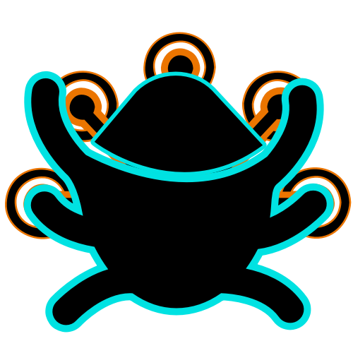
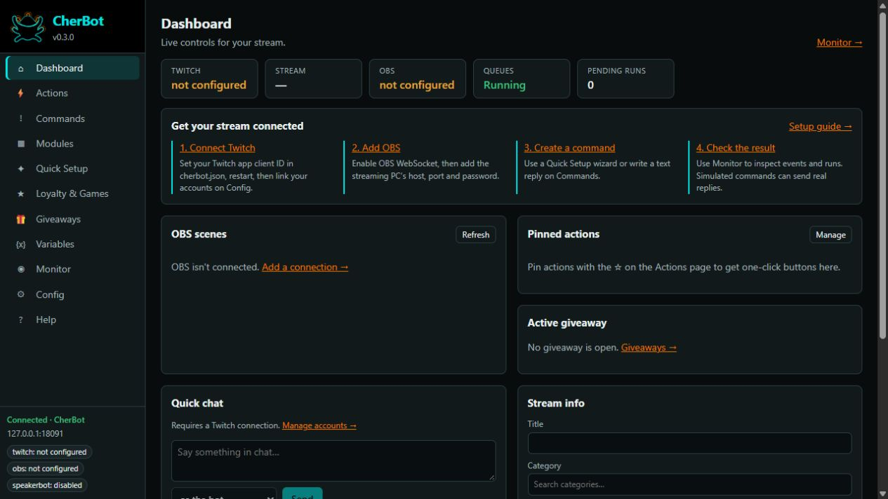

<div align="center">



# CherBot

### Stream automation. Native Linux. No Wine required.

Run the bot on your server. Control it from a browser, a terminal, or your Windows streaming PC.

**Headless engine · CLI & REST API · Visual action builder · Windows desktop app**

[Get started](#get-started) · [Build with AI](#build-your-automation-with-ai) · [Documentation](#documentation) · [Build from source](#build-from-source)

</div>

---

CherBot brings Streamer.bot-style automation to **Linux without a Wine workaround**. Its engine runs natively as a console app or background service, so your stream bot can live on an always-on Linux machine independently of the streaming desktop.

It is built to be workable from a terminal and by AI assistants: actions are structured JSON, the management API is authenticated HTTP, and imports, exports, account linking, and engine configuration are available from the CLI. Use the Web UI for visual controls, or the Windows tray app to host an engine locally or connect to a Linux service.

CherBot is an independent implementation with **partial Streamer.bot compatibility**. It imports existing actions and exposes compatible APIs, but does not implement every Streamer.bot trigger, sub-action, or C# method.

## Run it your way

| Setup | Engine | Interface |
| --- | --- | --- |
| **Linux server** | Native console app or systemd service | Web UI, CLI, REST API, or the Windows app in Remote mode |
| **Windows, all in one** | Hosted inside the tray app in Local mode | Desktop window, Web UI, tray controls |
| **Windows service** | Background Windows Service | Web UI or the Windows app in Remote mode |

The Windows app displays the engine's own Web UI. Connecting it to Linux gives you the same action builder and controls as opening the server in a browser.



*A fresh engine's dashboard. The browser and Windows desktop app share this interface.*

## What you can build

| Area | Included |
| --- | --- |
| **Automation** | Actions, typed triggers and steps, queues, timers, commands, conditions, loops, globals, C# scripts |
| **Twitch** | EventSub, Helix chat, rewards, subscriptions, follows, raids, moderation, channel tools |
| **OBS** | obs-websocket v5 connections, scene/source/filter controls, dashboard controls |
| **Community** | Custom text commands, loyalty points, six chat games, raffles, giveaways, chat alerts, emote pyramids, spam filtering |
| **Sound & speech** | Local playback, a browser-source sound overlay for headless hosts, Speaker.bot integration |
| **Management** | Live Admin chat and user inspection, run traces, a chat simulator, Quick Setup workflows, searchable help |
| **Song Requests** | Moderated YouTube, Apple Music and Spotify links; restricted YouTube browser player |
| **Optional history** | Local activity and points history, separate chat archive opt-in, earned-points rankings, retention and export/delete controls |
| **Sharing & AI help** | Portable feature packs with dependency previews, online CLI, version-matched prompts for external AI chats |
| **Migration** | Streamer.bot exports, `actions.json`, `commands.json`, Windows-to-Linux path mappings |

## Get started

Start with the [quick-start guide](docs/quick-start.md), also available in **Help → Quick start**. See [what's new in 0.4.0](CHANGELOG.md) for features and upgrade notes. Fresh installations keep CherBot's starter commands and presets, with no linked accounts or personal data.

Packaged builds are self-contained: **you do not need the .NET SDK to run them**. A source download needs to be built first; it is not a ready-to-run installation.

| Package | Choose this for |
| --- | --- |
| `cherbot-0.4.0-linux-x64.run` | Offline Linux x64 installer: user service, system service, or extraction only |
| `cherbot-0.4.0-linux-x64.tar.gz` | Linux x64 release archive, including the console app and service installer |
| `cherbot-desktop-win-x64.zip` | The Windows tray app, with Local and Remote modes |
| `cherbot-win-x64.zip` | The Windows console app or Windows Service |

Build artifacts are produced by GitHub Actions. See this repository's Actions page, or its Releases page when downloadable releases have been published.

### Linux

Download the Linux `.run` installer and install a user service (use the version in your downloaded filename):

```bash
bash cherbot-0.4.0-linux-x64.run --user
```

Use `sudo bash cherbot-0.4.0-linux-x64.run` for a system service instead. The `.run` file bundles the release and verifies its payload before installing; it needs no downloads. `--help` explains its modes. The matching `.sha256` file contains checksums for both release files.

Prefer an archive? Extract `cherbot-0.4.0-linux-x64.tar.gz`, open the resulting directory, and run `bash ./install.sh --user`. For console use without a service, run `./cherbot` from that directory. The archive preserves Unix executable permissions even when built on Windows. Older ZIP packages remain usable with `bash ./install.sh --user` after extraction.

For a user service:

```bash
# Get the token for the Web UI or a remote desktop connection.
~/cherbot/cherbot token --data-dir ~/.local/share/cherbot

# Follow logs or restart after editing cherbot.json.
journalctl --user -u cherbot -f
systemctl --user restart cherbot
```

The Web UI is at `http://127.0.0.1:8091/` on the engine machine. For a remote Linux host, bind `CherBot:Api:Address` to its LAN or VPN address, then use that address in your browser or Windows Remote profile. Keep the management API on a trusted network. The [installation guide](packaging/README-install.md) covers system-service paths, remote access, and staying running after logout.

### Windows

Extract the desktop package and run **`CherBot.Desktop.exe`**:

1. Choose **Local** to run the engine inside the app, or **Remote** to connect to a Linux/Windows service with its URL and API token.
2. Open **Config** to connect Twitch and OBS.
3. Create your first reply on **Commands**, or use **Quick Setup** for a command, alert, timer, or OBS scene shortcut.
4. Check **Monitor** for events and run results.

The desktop window requires Microsoft Edge WebView2. If the runtime is unavailable, the app offers to open the interface in your browser. Windows Service setup is covered in the [installation guide](packaging/README-install.md#windows).

### Connect Twitch and OBS

CherBot creates `cherbot.json` in its data folder on first run. Register your own public Twitch application, put its client ID under `CherBot:Twitch:ClientId`, restart, and link the broadcaster and optional bot account on **Config**. Headless linking is also available with `cherbot twitch-login broadcaster` and `cherbot twitch-login bot`.

For OBS, enable its WebSocket server and add the streaming PC's address, port, and password on **Config → OBS**. OBS and CherBot can run on different machines.

## Build your automation with AI

Open **Get AI Help** in the app to download the version-matched reference and build a prompt for your operating system and preferred shell. Ask an external chat for complete CherBot CLI commands and JSON files, then preview shared feature packs on **Sharing**. Credentials stay in local token files.

Describe what you want to ChatGPT, Arena, DeepSeek Chat, or another AI chat that accepts file attachments. Give it CherBot's reference so it can use the functions and variables this engine actually supports.

**Upload [cherbot-ai-reference.txt](docs/cherbot-ai-reference.txt), then paste the [reusable prompt](docs/cherbot-ai-prompt.txt).** On GitHub, open the text file and download its raw contents. Packaged builds include both files in `docs/`.

For example:

> I run CherBot on Linux and OBS on Windows. Make a moderator-only `!brb` command that switches OBS to my “Be Right Back” scene and replies in chat. Give me exact setup steps and a way to test it.

Or start with:

```text
Use the attached CherBot AI reference as the source of truth.
I want: [describe the command, alert, reward, timer, or workflow].
My engine runs on: [Linux / Windows Local / Windows Service].
My integrations and exact scene/source names: [fill these in].
Return: [Web UI steps / C# script / importable JSON / CLI + HTTP commands].

Use only supported functions, trigger IDs, fields, and variables from
the reference. State missing information instead of inventing it.
Give complete code or JSON, explain where to put it, and include a test.
Call out any test that sends real chat or changes OBS.
```

The reference includes supported `CPH` signatures, template rules, trigger variables, step fields and options, JSON examples, and CLI/API workflows. It contains no account credentials. Upload that reference; keep your API token, passwords, `keys/`, and private configuration on your own machine.

See [the AI guide](docs/ai-guide.md) for more examples and refreshing the reference. A reference helps an AI produce a usable answer; preview imports and inspect generated code before running it.

## Terminal & API workflow

The online CLI can inspect or configure an already running local or remote engine:

```bash
cherbot api GET /v1/actions --url http://127.0.0.1:8091 --token-file /path/to/api-token
cherbot pack preview feature.json --url http://127.0.0.1:8091 --token-file /path/to/api-token
cherbot pack apply feature.json --url http://127.0.0.1:8091 --token-file /path/to/api-token
```

Use `--body-file request.json` for API writes. Packs include supported configuration dependencies, require explicit conflict replacement/mapping, and import actions, commands and timers disabled. Existing offline imports and Streamer.bot exports remain available.

The CLI handles engine lifecycle and offline import/export. The authenticated management API handles a running engine.

These examples assume `cherbot` is on your `PATH`. Otherwise use `~/cherbot/cherbot` on Linux or `.\cherbot.exe` from the Windows build folder.

```bash
cherbot --data-dir /path/to/data
cherbot token --data-dir /path/to/data
cherbot import workflow.json --dry-run --data-dir /path/to/data
cherbot import workflow.json --no-overwrite --data-dir /path/to/data
cherbot export --name "My stream" --data-dir /path/to/data > stream-export.txt
```

Inspect a running engine without opening a GUI:

```bash
CHERBOT_URL=http://127.0.0.1:8091
CHERBOT_TOKEN="$(cherbot token --data-dir /path/to/data)"

curl --fail-with-body "$CHERBOT_URL/health"
curl --fail-with-body -H "Authorization: Bearer $CHERBOT_TOKEN" "$CHERBOT_URL/v1/actions"
curl --fail-with-body -H "Authorization: Bearer $CHERBOT_TOKEN" "$CHERBOT_URL/v1/runs?limit=10"
```

Use one process per data folder. Stop the service before offline imports into its database; use the API for changes while it is running. Back up the entire data folder, including encryption keys, before migration.

## Bringing existing Streamer.bot actions

Import an export string, `actions.json`, or `commands.json` on **Actions → Import**, or use `cherbot import` from a terminal. Preview the report first.

- Unsupported triggers and steps are preserved for round trips; they do not become working Linux features.
- Scripts can use CherBot's `CPH` subset and portable .NET libraries. Windows-specific libraries and desktop interactions need an appropriate Windows environment.
- Configure `Engine:PathMappings` when moving sound/file paths to Linux.
- The compatible WebSocket server defaults to `ws://127.0.0.1:8080/`. Optional compatible HTTP and UDP servers are disabled by default.
- Speaker.bot integration talks to a separate Speaker.bot instance; it does not make Speaker.bot itself a native Linux application.

## Documentation

| Guide | What it covers |
| --- | --- |
| [Install and run](packaging/README-install.md) | Services, data folders, remote connections, account linking, import/export |
| [Quick start](docs/quick-start.md) | Fresh-install setup, first workflows, monitoring and sharing |
| [What's new](CHANGELOG.md) | Release features, defaults and upgrade notes |
| [Operating guide](docs/operating-guide.md) | Everyday operation, modules, actions, scripting, troubleshooting |
| [Configuration reference](docs/configuration-reference.md) | Configuration keys, defaults, environment variables, CLI overrides |
| [AI guide and prompt](docs/ai-guide.md) | Asking a chat assistant for a workflow you can use |
| [Uploadable AI reference](docs/cherbot-ai-reference.txt) | Supported variables, functions, triggers, fields, examples |

The Web UI also includes searchable **Help**, a variable picker, and references for supported triggers and sub-actions.

## Build from source

Requires the **.NET 8 SDK** selected by `global.json`. **Node.js 20+** is used for UI tests and the reference exporter.

```bash
dotnet build CherBot.sln -c Release
npm ci --prefix tests/compat-client
dotnet test tests/CherBot.Tests -c Release
node --test tests/ui
```

Publish self-contained builds:

```powershell
# Windows and Linux engines, plus the Windows desktop app.
./packaging/publish.ps1 -Zip
```

```bash
# Linux engine; pass linux-arm64 to target ARM64.
bash ./packaging/publish.sh
```

Outputs go to `artifacts/`. The Web UI uses plain ES modules with no frontend build step.

To build the versioned Linux archive, offline installer, and checksums, use **Python 3.11+** with the .NET SDK:

```bash
python packaging/package_linux.py
# Optional ARM64 build: python packaging/package_linux.py --rid linux-arm64
```

The files go to `artifacts/linux-release/`. This builder runs on Windows or Linux and assigns Linux permissions explicitly. CI also packages these files and runs a native Linux startup check. See [Linux packaging](packaging/README-linux-release.md) for verification and installer modes.

<details>
<summary>Source layout</summary>

| Folder | Contents |
| --- | --- |
| `src/CherBot.Core` | Actions, queues, triggers, commands, variables |
| `src/CherBot.Integrations` | Twitch, OBS, Speaker.bot, community features and modules |
| `src/CherBot.Compat` | Compatible APIs and importer |
| `src/CherBot.Scripting` | C# compilation and supported CPH implementation |
| `src/CherBot.Host` | Engine executable, management API, embedded Web UI |
| `src/CherBot.Desktop` | WPF/WebView2 Windows tray app |
| `tests/` | Engine, integration, compatibility, UI tests |
| `tools/` | AI reference exporter and type-map generator |

`tools/GenTypeMaps` uses external type data not included here. Generated maps are checked in, so normal builds do not need those inputs.

</details>

---

CherBot is independent and is not affiliated with or endorsed by Streamer.bot, Twitch, or OBS.
